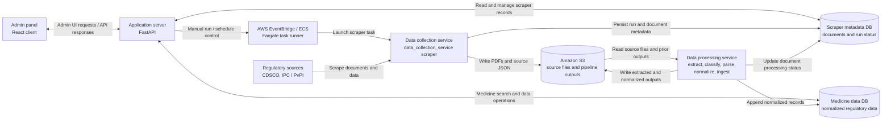

# Medicine Scanner Research

This repository combines the research pipeline, the operational app backend, and the cloud scraper worker.

## Runtime Architecture



The admin panel is the React app in `client/`; it calls the FastAPI server in `server/`. The server controls scraper runs through AWS, while the scraper worker is implemented in `data_collection_service/scraper/`. S3 is the shared file handoff between collection and processing; the two databases hold scraper metadata and normalized medicine data, respectively.

The repository has four runtime parts and one research workflow:

- [client](client) — the React admin panel
- [server](server) — the FastAPI application layer: database access, scraper scheduling, and the run-approval (human-in-the-loop) API
- [data_collection_service](data_collection_service) — the scraper worker that downloads CDSCO / IPC documents to S3 and starts the processing pipeline
- [data_processing_service](data_processing_service) — extraction (with OCR), classification, parsing, normalization, and append-only ingest; see its [README](data_processing_service/README.md)
- [initial_data_ingestion](initial_data_ingestion) — the original numbered, stage-based research workflow used for the first data load

## Repository structure

```text
.
├── README.md
├── requirements.txt
├── client/                     React admin panel
├── server/                     FastAPI app, databases, pipeline approval API
├── data_collection_service/    scraper worker (Docker / ECS)
├── data_processing_service/    processing pipeline (Docker / ECS + Step Functions)
│   ├── extractor/              PDF text, tables and OCR
│   ├── classifier/             deterministic rules + GLiClass
│   ├── parser/                 table and narrative record parsing
│   ├── normalizer/             staging CSVs for the medicine database
│   ├── ingester/               append-only database ingest
│   ├── processor/              parser → normalizer → ingester for one run
│   ├── sfn/ and tasks/         Step Functions and ECS task definitions
│   └── tests/                  unit tests and the real-PDF regression set (tests/regression)
└── initial_data_ingestion/     numbered research workflow (00_project_support … 09_normalization)
```

## Research workflow

The numbered workflow in [initial_data_ingestion/README.md](initial_data_ingestion/README.md) follows these stages:

1. `00_project_support` — project docs and flow definitions
2. `01_downloads` — download source PDFs and data (also the location of the regression-test PDFs)
3. `02_light_extraction` — quick page-level extraction for review
4. `03_ai_classification` — AI-assisted classification and output contract
5. `04_classified_documents` — copy/route files into classified groups
6. `05_type_classification` — determine document type and extraction mode
7. `06_raw_extraction` — full extraction and OCR processing
8. `08_json_conversion` — convert extracted output into structured JSON
9. `09_normalization` — normalization, validation, and downstream preparation

## Setup

Create a virtual environment and install the project dependencies:

```powershell
python -m venv .venv
.\.venv\Scripts\Activate.ps1
python -m pip install -r requirements.txt
```

The processing service has its own per-image requirements; see [data_processing_service/README.md](data_processing_service/README.md) for running its stages and tests.

## Notes

- Source data, extracted content, and intermediate outputs are preserved for auditability.
- Generated outputs are kept out of git through the stage-specific `.gitignore` rules.

## Related documentation

- [data_processing_service/README.md](data_processing_service/README.md)
- [server/README.md](server/README.md)
- [initial_data_ingestion/README.md](initial_data_ingestion/README.md)
- [initial_data_ingestion/00_project_support/PIPELINE_STEPS.md](initial_data_ingestion/00_project_support/PIPELINE_STEPS.md)
