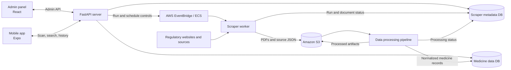

# Medicine Scanner Research

## 1. Overall Flow

This repository brings together the MediCheck admin panel and mobile app, a FastAPI backend, a cloud scraper, and medicine-data research and processing pipelines. The main working areas are `client/` (React admin UI), `mobile_app/` (Expo app), `server/` (API), `data_collection_service/` (scraper worker), `data_processing_service/` (PDF/data processing), `initial_data_ingestion/` (stage-based ingestion workflow), and `data_pipeline_research/` (experiments and research).



### Admin flow

An allowed admin signs in through the admin API and uses the React panel to view dashboard, scraper, and system status. Admin workflow tools can inspect runs, events, manifests, and normalized artifacts, then approve or reject a run. Run controls connect the application to the AWS scraper and processing workflow.

### Mobile app flow

The user signs in, then scans a barcode, captures medicine text for OCR, or enters details manually. The app sends the scan to the API, which looks up matching medicine data and returns a result; if key information such as the batch number is missing, the user can complete it manually. The app displays the result and keeps scan history available.

For regulatory checks, the intended flow is to compare normalized batch/product details against quality alerts, check ingredient-based drug status and its scope, and check adverse-reaction signals. These are separate findings: an adverse-reaction signal is not a recall or ban, and no match means only that no match was found in the available data—not that a medicine is safe or genuine.

### Data processing flow

The scraper collects documents and source data from regulatory sources, stores files and source JSON in S3, and records run/document metadata in the scraper database. The processing workflow profiles and extracts source material, classifies relevant content, parses and validates records, normalizes values, and ingests approved/ready records into medicine data storage. Intermediate artifacts and processing status are retained for review and traceability. The numbered workflow in `initial_data_ingestion/` and experiments in `data_pipeline_research/` support this work.

# Medical IDP Pipeline -- Proposed Architecture

## 1. Purpose

This document explains the proposed end-to-end workflow for processing
medical PDF documents.

The pipeline first identifies what type of document it is, then extracts
enough information to classify it. After classification, it reconstructs
only the required content in a detailed and consistent structure. The
final stages parse, validate, normalize, and store the data.

## 2. High-Level Workflow

```text
PDF Input
   |
   v
1. Document Profiler
   |
   v
2. Extraction
   |
   v
3. Classification Context Builder
   |
   v
4. Classifier
   |
   v
5. Content Filtering and Routing
   |
   v
6. Reconstruction
   |
   v
7. Parsing
   |
   v
8. Validation
   |
   v
9. Normalization
   |
   v
10. Database Ingestion
```

## 3. Stage-by-Stage Explanation

### Stage 0 -- PDF Input

**Purpose:** Receive the PDF and create a basic record for tracking it
through the pipeline.

**Technical approach:** - Accept the PDF as input. - Generate a unique
document ID. - Calculate a file hash to help identify duplicate files. -
Store basic file details such as file name, size, and upload time.

**Output:** `document_manifest.json`

### Stage 1 -- Document Profiler

**Purpose:** Understand the basic properties and layout of the PDF
before extracting its content.

**Technical approach:** - Use PyMuPDF to inspect PDF metadata and
pages. - Check page count, page dimensions, and whether pages contain
selectable text. - Identify likely digital, scanned, or mixed
documents. - Collect basic layout and document-level information.

**Output:** `profile.json`

### Stage 2 -- Extraction

**Purpose:** Extract text and other available evidence from the PDF.

**Technical approach:**

- **Digital PDFs:** Use PyMuPDF for text and page-level evidence. Use
  PyMuPDF4LLM to generate Markdown with useful document structure,
  such as headings, paragraphs, and tables where detected.
- **Scanned PDFs:** Use RapidOCR to recognize text from page images.
  PyMuPDF4LLM can then be used to produce structured Markdown from the
  OCR text, depending on the selected integration.
- Preserve page references and bounding boxes wherever available.

The extraction stage should retain the evidence needed for later
processing. Markdown is useful for reading and classification, but it
should not be treated as the complete source of layout information.

**Output:** `extraction.json` and supporting page/Markdown artifacts.

### Stage 3 -- Classification Context Builder

**Purpose:** Prepare a lightweight view of the extracted content for the
classifier.

This stage does not perform full document reconstruction. It only
prepares enough context to help the classifier understand the document
and identify relevant content.

**Technical approach:**

- **Paragraphs:** Use the complete grouped paragraph content from
  PyMuPDF4LLM Markdown. Keep page numbers and other available
  references.
- **Tables:** Extract lightweight table information, such as:
  - Table headers
  - Two or three representative sample rows
  - Page number
  - Bounding box, if available
  - Row and column counts
- Avoid reconstructing every table cell at this stage.

**Output:** `classification_context.json`

**Important:** This JSON is only an input to the classifier. It is not
the final structured document and must not be used as the source of
truth for parsing or database ingestion.

### Stage 4 -- Classifier

**Purpose:** Identify the document type and classify its content using
the project's taxonomy.

**Technical approach:** - Read `classification_context.json`. - Apply
deterministic taxonomy rules first where possible. - Use an LLM as a
fallback for cases that need semantic understanding. - Assign the
relevant document or content labels, such as the configured A--AV and
P1--P30 taxonomy labels. - Record classification results and
confidence/evidence where supported by the implementation.

**Output:** `classification.json`

### Stage 5 -- Content Filtering and Routing

**Purpose:** Decide which parts of the document need detailed
processing.

**Technical approach:** - Read the classification results. - Apply
processing rules for the identified document and content types. - Mark
relevant sections, paragraphs, and tables for reconstruction. - Skip or
route content that does not require the detailed downstream pipeline. -
Keep a record of the decisions so the processing path can be reviewed.

**Output:** `processing_manifest.json`

### Stage 6 -- Reconstruction

**Purpose:** Reconstruct the required content in a detailed, unified
structure.

This stage runs after classification so that detailed processing can
focus on the content that matters.

**Technical approach:** - Use PyMuPDF and the extraction evidence for
digital PDF content. - Use RapidOCR output and page geometry for scanned
content. - Reconstruct paragraphs using text lines, positions, spacing,
alignment, and page layout. - Reconstruct tables into rows and columns.
Preserve cell values and layout details where possible. - Retain page
numbers, bounding boxes, source references, and extraction provenance
wherever available. - Represent paragraphs and tables in one consistent
document schema.

**Output:** `structured_document.json`

This is the canonical structured representation used by the downstream
stages.

### Stage 7 -- Parsing

**Purpose:** Convert the reconstructed content into domain-specific
records and fields.

**Technical approach:** - Read `structured_document.json`. - Use Python
parsers and taxonomy-specific parsing rules. - Use Pydantic models for
structured data representation. - Use an LLM only where rule-based
parsing is not sufficient and the use case allows it.

**Output:** `parsed_records.json`

### Stage 8 -- Validation

**Purpose:** Check whether the parsed records are complete, correctly
typed, and logically valid.

**Technical approach:** - Validate data types and required fields using
Pydantic. - Apply domain-specific validation rules. - Check
relationships and consistency between fields. - Record validation errors
and warnings instead of silently changing uncertain values.

**Output:** `validated_records.json`

### Stage 9 -- Normalization

**Purpose:** Convert validated values into consistent formats.

**Technical approach:** - Standardize names, units, dates, and other
domain-specific values. - Apply controlled mappings and normalization
rules. - Preserve the original extracted value where traceability is
required. - Avoid guessing when a value is missing or unclear.

**Output:** `normalized_records.json`

### Stage 10 -- Database Ingestion

**Purpose:** Store the normalized records in the database.

**Technical approach:** - Use Python with Supabase/PostgreSQL. - Map
normalized records to the database schema. - Apply duplicate checks and
appropriate insert/upsert logic. - Record successful writes and failures
for audit and retry.

**Output:** `ingestion_result.json`

## 4. Important Design Decisions

### A. Classification happens before detailed reconstruction

The classifier needs enough content to identify the document and
relevant sections, but it does not need every table cell to be
reconstructed first.

The Classification Context Builder therefore creates a lightweight
input. Detailed reconstruction happens only after classification and
routing.

### B. Two different JSON artifacts have different purposes

---

  Artifact                        Purpose                 Used by

---

  `classification_context.json`   Lightweight paragraphs  Classifier only
                                  and table samples for
                                  classification

`structured_document.json`      Detailed, unified       Parser and all
                                  representation of the   downstream stages
                                  required document
                                  content
-----------------------------------------

These files serve different purposes and should not be treated as
interchangeable.

### C. Preserve traceability

Where available, retain page numbers, bounding boxes, source element
IDs, and extraction method details. This makes it easier to trace a
parsed value back to its location in the original PDF.

### D. Keep uncertain data explicit

If OCR or extraction produces unclear content, preserve the uncertainty
and report it through validation or review. Do not silently invent
missing values.

## 5. Summary

The proposed pipeline separates **classification preparation** from
**detailed reconstruction**.

First, the system profiles and extracts the PDF. The Classification
Context Builder prepares lightweight content, and the classifier
identifies what needs to be processed. The routing stage then selects
the relevant content for detailed reconstruction into a unified JSON
structure. Finally, the system parses, validates, normalizes, and
ingests the resulting records into the database.

This approach aims to reduce unnecessary reconstruction work while
keeping the downstream data structured, consistent, and traceable.

# MediCheck Data Foundation

# Part 1. Taxonomy summary

## 1.1 The two taxonomies and how they fit together

|               | Table taxonomy                                                                                                | Paragraph taxonomy                                                                             |
| ------------- | ------------------------------------------------------------------------------------------------------------- | ---------------------------------------------------------------------------------------------- |
| Scope         | Structured tables and list rows in CDSCO PDFs                                                                 | Prose passages and operative paragraphs                                                        |
| IDs           | Archetypes **A to AV**                                                                                  | **P1 to P30**, plus P3b and P3c                                                          |
| Basis         | 672 raw table types detected, deduplicated to about 45–55 genuine schemas, of which about 16 are high-volume | 3,029 paragraph records across 343 Markdown source paths, grouped into 14 exploratory clusters |
| Output per ID | Canonical columns, column variants seen in the wild, sample files                                             | Meaning, app use, priority, mapping to table archetypes                                        |

How they relate:

- A paragraph that is structurally a table or list row uses the table archetype and its schema (A to AV).
- A prose passage that independently states a finding, restriction, warning or status uses a P-series ID.
- One PDF can hold several record types, both tables and prose. Each table and each record is classified independently. One classification is never forced onto a whole document.
- The 14 clusters are routing aids for review, not legal or app taxonomies. A single cluster can mix usable actions, references and administrative notices.

## 1.2 The classification model

Every item gets exactly one of three **app classification** values.

| Class                   | Meaning                                                                                                                                                                   |
| ----------------------- | ------------------------------------------------------------------------------------------------------------------------------------------------------------------------- |
| **Usable**        | Directly supports a current medicine check: batch quality, falsified product, prohibition status, restriction status, or adverse-reaction alert.                          |
| **Future-usable** | Retain and classify, but defer extraction until a relevant feature is in scope (device, veterinary, IVD, analytics, reference, recall/fraud, advisory, regulatory watch). |
| **Non-usable**    | Administrative, procedural, technical or aggregate records with no direct consumer verification value. Keep the source file, but do not prioritise extraction.            |

Four fields are kept **independent** and never merged into one:

1. `app_classification` (the three values above, nothing else)
2. `priority` (P0 first, then P1, then deferred P2 and P3)
3. `legal_status` (what the source says about the record's legal force)
4. currentness / supersession (is it still in force, was it replaced)

Priority meaning: **P0** = direct quality and status findings, extracted first. **P1** = qualifying alerts, extracted next. **P2** = default for deferred Future-usable items. **P3** = Non-usable.

A final administrative notice is still Non-usable. A proposed product-specific restriction can be Usable only when it is clearly shown as proposed and never as binding.

## 1.3 Table taxonomy: the Usable archetypes

| ID           | Dataset                                        | Priority | Canonical columns                                                                                     | Notes                                                                                                                                                        |
| ------------ | ---------------------------------------------- | -------- | ----------------------------------------------------------------------------------------------------- | ------------------------------------------------------------------------------------------------------------------------------------------------------------ |
| **A**  | CDSCO Monthly Drug Alert / NSQ list (85+ docs) | P0       | sno, product_name, batch_no, mfg_date, exp_date, manufacturer, failure_reason, drawn_by, lab          | Optional: report_no_form13, remarks, firms_reply. One composite variant packs batch / mfg / expiry / manufacturer into one cell and must be split into four. |
| **B**  | State NSQ alert (12+ docs)                     | P0       | Same as A, but `lab` is the state laboratory and `nsq_result` is free text                        | Monthly files, mid-2024 onward.                                                                                                                              |
| **C**  | Spurious drug list (10+ docs)                  | P0       | Same core as A, plus firms_reply and remarks                                                          | Manufacturer is often "Under Investigation". Remarks contain wording like "spurious / section 17B(e)". Mixed-document rule applies (see 1.6).                |
| **K**  | FDC prohibition / restriction list (12+ docs)  | P0       | sno, name_of_fdc, strength, dosage_form, notification_no_date, optional date_of_central_govt_approval | Prohibited, restricted and conditionally permitted combinations stay distinct. The Category C (18-month policy) list is not a prohibition list.              |
| **AR** | Banned drugs list                              | P0       | sno, drug_name, notification_no                                                                       | Retain notification and scope.                                                                                                                               |
| **Z**  | PvPI drug safety alert list (1 document)       | P1       | sno, issue_date, suspected_drug, indication, adverse_drug_reaction                                    | An adverse-reaction signal, not a recall or prohibition.                                                                                                     |
| **AQ** | WHO fraudulent drug alert (1–2 docs)          | P1       | product_name, stated_value, actual_value                                                              | Falsified product and lot checks.                                                                                                                            |
| **AV** | Product recall / safety alert                  | P1       | Variable recall identifiers (product, batch, mfg date, expiry)                                        | Variable layout.                                                                                                                                             |

Batch NSQ, spurious and banned findings are distinct from adverse-reaction alerts. Legal status and scope must be verified before any regulatory warning is shown.

## 1.4 Table taxonomy: Future-usable and Non-usable

**Future-usable (archive, defer extraction):** E (NOC / clarification register), AT (approved products for marketing, historical only), AE (reference products for BE studies), AC (NLEM tables), D and AS (device risk classification and device alerts), F (laboratory list), M (COVID / PCR kits), J (veterinary vaccines), R (SAE / PSUR), AU (registration certificate holders), AM (donor / patient / cosmetic registration data). Also: the brand-level summary of the country-wide spurious-drug survey, and the Top-300 QR mandate records (not covered by A to AV, so source and applicability must be assessed first).

**Non-usable:** G, H, I, L, N, O, P, Q, S, T, U, V, W, X, Y, AA, AB, AD, AF, AG, AH, AI, AJ, AK, AL, AN, AO, AP. These are fee schedules, indexes, checklists, glossaries, meeting schedules, rosters, forms, stability designs, standards, statistics and similar administrative material.

## 1.5 Paragraph taxonomy

**Usable (current medicine checks)**

| ID            | What the passage says                                                                                     | App use                                        | Priority | Maps to table         |
| ------------- | --------------------------------------------------------------------------------------------------------- | ---------------------------------------------- | -------- | --------------------- |
| **P1**  | Batch- or sample-specific finding that a named medicine is spurious, falsified, adulterated or misbranded | Historical batch-level falsified-product check | P0       | C (AQ for WHO-origin) |
| **P2**  | Batch-specific NSQ narrative outside a table                                                              | Batch quality-failure check                    | P0       | A, B                  |
| **P3**  | Operative prohibition of a named medicine, formulation or FDC                                             | Prohibited-status check                        | P0       | K, AR                 |
| **P3b** | Operative restriction with stated conditions (indication, age, dose, population), not an outright ban     | Restricted-status check                        | P0       | K                     |
| **P3c** | Explicit conditional permission or continued-use pathway, including Category C / 18-month policy          | Conditional-status check                       | P0       | K                     |
| **P4**  | Prose banned-drug list or explicit Section 26A prohibition                                                | Banned-status check                            | P0       | AR (K for FDCs)       |
| **P5**  | Product recall or safety communication naming the product and, where available, batch                     | Conditional                                    | P1       | AV                    |
| **P6**  | WHO or other international falsified-medicine alert                                                       | Conditional                                    | P1       | AQ                    |
| **P7**  | PvPI alert with suspected drug and adverse reaction (batch optional)                                      | Adverse-reaction check                         | P1       | Z                     |
| **P8**  | Product- or class-specific warning or labelling advice (not a ban, batch finding or recall)               | Future-usable by default                       | P1       | none                  |

**Future-usable:** P9 (device alerts and classification), P10 (approved-for-marketing list), P11 (registration certificate holders), P12 (NOC register), P13 (BE reference products), P14 (NLEM), P15 (laboratory listings), P16 (veterinary), P17 (IVD / COVID kits), P18 (SAE / PSUR analytics), P19 (aggregate surveys, brand-level counts), P29 (general rule amendments and formal drafts), P30 (historical or emergency measures kept for provenance).

**Non-usable:** P20 (BE / NOC procedure and forms), P21 (BA/BE centre checklists), P22 (generic FAQ), P23 (committee reports), P24 (meeting minutes), P25 (enforcement procedure), P26 (administrative gazette notices), P27 (corrigenda to procedural rules), P28 (informational notices).

### The current app-scope gate

The P-ID describes what a passage says. It does not by itself make the passage ready for direct matching, so readiness is tracked separately.

| IDs               | Decision                 | Direct-use condition                                                                                                                         |
| ----------------- | ------------------------ | -------------------------------------------------------------------------------------------------------------------------------------------- |
| P1–P2            | Direct usable            | Medicine name, batch number, manufacturer **and** failure reason/result all present. Otherwise retained but not ready.                 |
| P3–P4            | Direct usable            | Source supports the named medicine/FDC and the operative prohibition. Preserve exact scope and legal status.                                 |
| P3b–P3c          | Direct usable            | Source supports the named product and the restriction or conditional permission. Preserve every condition; never turn it into a blanket ban. |
| P5–P6            | Conditional              | Direct only if the record satisfies one of the three current checks, else Future-usable.                                                     |
| P7                | Direct usable            | Suspected drug and adverse reaction present. Batch optional.                                                                                 |
| P8                | Future-usable by default | Promote only if a record independently satisfies a current check.                                                                            |
| P9–P19, P29–P30 | Future-usable by default | Promote only if a specific actionable record independently satisfies a current check.                                                        |
| P20–P28          | Non-usable by default    | Extract any independently actionable product finding separately.                                                                             |

The paragraph taxonomy defines **three current checks**: spurious/NSQ findings, prohibition/banned-drug status, and PvPI adverse-reaction alerts.

## 1.6 Cross-cutting rules

1. **A missing match is not proof of safety.** It is an unsuccessful search, shown separately from confirmed findings. It does not mean a medicine is safe, genuine, approved or unrestricted.
2. **Distinct statuses.** Prohibited, restricted and conditionally permitted never merge. Category C is not a ban; keep its exact legal basis and conditions.
3. **Status updates belong to the same product record.** A rescission, supersession, correction or amendment of a P3/P3b/P3c/P4 record is linked to that record. No conflicting parallel alert is created. History is retained for audit.
4. **Record-level classification.** Classify each record by product type. Mixed medicine / device / veterinary / cosmetic documents contribute only their in-scope medicine records.
5. **Table rows and prose findings.** For monthly alerts, extract both qualifying table rows (A/B/C) and independent prose findings (P1/P2). Do not count a table row again as a paragraph alert without distinct evidence.
6. **Spurious survey (PDF 3257) has two record types.**
   - Brand-level summaries with sample counts and manufacturer-reported findings are Future-usable only, for historical trend analysis. They must never drive an individual product or batch verdict (P19).
   - Individual spurious-sample records that identify product, batch, manufacturer, sample number and investigation context are Usable under C.
   - The records are historical (2007–2009, some expiries 2010–2011). Keep original dates and mark them historical. A finding for one sample is never generalised to every pack of the brand.
7. **Historical approval is not proof of current status** (relevant to AT, P10).
8. **Draft or proposed text stays proposed.** It is never shown as binding.

### Legal status and display semantics

| `legal_status`                                                 | Display rule                                                                     |
| ---------------------------------------------------------------- | -------------------------------------------------------------------------------- |
| `final_or_effective_explicitly_stated` (on a Usable archetype) | May be shown as a confirmed finding only after scope and source verification     |
| `draft_or_proposed_explicitly_stated`                          | Show only as proposed / under consultation                                       |
| `administrative_or_informational`                              | Context only, never a product verdict                                            |
| `banned`                                                       | Accept only when the exact evidence quote supports the prohibition and its scope |
| `repealed`, `rescinded`, `superseded`, corrected           | Link to the parent record, reflect the current operative status, retain history  |
| `unclear_from_excerpt` or missing                              | Do not display as a finding; queue for review or re-extraction                   |

**Minimum evidence to promote a Usable record:** an exact `evidence_quote` (never a generated summary); source document and page or section; publication or effective date where present; named product and scope; action/status and conditions; `legal_status`; and a review of any linked corrigendum, revocation or superseding notice.

### Data-handling rules

- Preserve original PDFs, source references and verbatim operative wording.
- Keep a document inventory with: `document_name`, `category`, `subcategory`, `source_authority`, `publication_date`, `regulatory_status`, `reason_for_classification`, `extraction_status`, `last_verified_date`.
- Treat table extraction and paragraph extraction as distinct, but link them to the same source document.
- Classifications, cluster names and model labels are review aids, not legal determinations. The taxonomy does not verify that a notification remains in force.

## 1.7 Cluster routing and known corrections (short form)

The 14 clusters give a default review route (for example, cluster 2 "FDC prohibitions and restrictions" defaults to P3/P3b/P3c, while clusters 0, 3, 4 and 7 default to P29 rule monitoring). Every cluster route is overridden by record-level classification. The paragraph file lists specific document corrections, for example: documents 3235, 3237, 3238, 3240 and 4473 are Non-usable; 13750 (Nimesulide immediate-release action) and 2373 (Buclizine restriction) are human-medicine product-status records (P3 or P3b); 10980, 1353 and 3771 must be read for rescissions or corrections that update a linked P3/P3b/P3c/P4 record.

## 1.8 Small housekeeping notes on the taxonomy files

- In `table_taxonomy_for_app.md`, a stray table row (`| C | Spurious Drug List | ...`) sits inside the C sample-file list, and two rows at the end of the Future-usable table (the country-wide survey and the Top-300 QR mandate) are missing their leading pipe, so they will not render as table rows.
- The table taxonomy lists AV and AQ as Usable (P1), while the paragraph taxonomy treats their prose forms P5 and P6 as conditional. The current schema follows the stricter reading and defers them (see 3.10).

---

# Part 2. The previous schema

## 2.1 What it was

A normalised, entity-centred design with a generic event table in the middle.

| Group       | Tables                                                                                                            | Role                                                                                                                                                                                                                                    |
| ----------- | ----------------------------------------------------------------------------------------------------------------- | --------------------------------------------------------------------------------------------------------------------------------------------------------------------------------------------------------------------------------------- |
| Lineage     | `regulatory_documents`, `raw_source_records`                                                                  | Source PDF registry and raw extracted rows                                                                                                                                                                                              |
| Master data | `products`, `ingredients`, `product_ingredients`, `organizations`, `product_organizations`, `batches` | Canonical products, compositions, companies and batches                                                                                                                                                                                 |
| Events      | `regulatory_events`                                                                                             | One table for every regulatory fact: 14 event types (BANNED, PROHIBITED, NSQ, SPURIOUS, ADR, RECALL, APPROVAL, NOC, and others), 5 scopes (BATCH, PRODUCT, INGREDIENT, COMBINATION, DOCUMENT), plus an `additional_data` jsonb column |
| Plumbing    | `staging_key_map`                                                                                               | Maps staging keys to final IDs                                                                                                                                                                                                          |

## 2.2 What worked

- The lineage pair (hashed documents plus raw records with `raw_json`) is the right idea and is kept in the current design.
- Key-based identifiers supported repeatable loads.

## 2.3 Why it caused problems

1. **One generic event table for different record shapes.** An NSQ finding needs a batch, a ban does not, and a PvPI alert needs a reaction. With every type forced into one table, many columns were empty for most rows.
2. **Entity resolution at load time.** Each row had to be resolved into product, batch and organisation IDs before it could be stored. A single parser or classifier miss meant a failed row or a wrongly linked one, which showed up as data mismatches and missing columns.
3. **`additional_data jsonb` became the place for anything unclear**, which hides missing fields instead of catching them.
4. **It did not model the taxonomy.** There was no restricted or conditionally permitted event type, no effective date or supersession link (`status` defaulted to `ACTIVE`), no review state, and no required-field gate for direct matching.
5. **Out-of-scope product types** (devices, cosmetics, IVD kits) were allowed in `products.product_category`, although the taxonomy keeps them out of current medicine checks.
6. **A bug:** `regulatory_documents.file_hash` was typed `character` with no length, which is `char(1)` in PostgreSQL, so a hash could not be stored.

The root cause was partly upstream: the extractor, classifier and parser were not yet reliable and the taxonomy did not exist. The schema, however, made every upstream error fatal.

---

# Part 3. The current schema (detailed)

The executable DDL is in `medicheck_schema.sql`. It was loaded into PostgreSQL 16 and tested locally (see 3.11).

## 3.1 Design principles

1. **Three typed tables, each with a fixed shape** (alerts, drug status, adverse-reaction alerts), matching the three current checks.
2. **Only validated rows enter typed tables.** Required fields are `NOT NULL`. A row that fails stays in `raw_source_records` as `needs_review`.
3. **Provenance on every row.** Each typed row points to its raw source record, which points to the document (page, file, hash, publication date).
4. **Legal history is append-only.** One row per notification; nothing is overwritten.
5. **The app reads approved rows only**, enforced by row-level security.
6. **Matching is tiered.** Results are `confirmed`, `possible`, `exact`, `review` or `component`, never a bare yes/no.
7. **A missing match is never a safety claim.**

## 3.2 Architecture

```
PDF
 └─ regulatory_documents          one row per source file (hash, S3 key, inventory fields)
     └─ raw_source_records        one row per extracted row or passage (raw_json, parse_status)
         ├─ alerts                step 1: batch-level NSQ and spurious findings
         ├─ drug_status_events    step 2: FDC / banned / restricted history (append-only)
         └─ suspected_drugs       step 3: PvPI adverse-reaction alerts

Query layer (called per scan):
  check_alerts()  ·  drug_status_as_of()  ·  check_adverse_signals()
Views: v_drug_status_timeline · v_unresolved_references · v_review_queue
Row-level security: app role sees approved rows only; pipeline uses the service role
```

## 3.3 Shared building blocks

| Item                 | Definition                                                                                                                                                     | Why                                                                      |
| -------------------- | -------------------------------------------------------------------------------------------------------------------------------------------------------------- | ------------------------------------------------------------------------ |
| `review_state_t`   | `pending`, `approved`, `rejected`                                                                                                                        | Replaces a ready/not-ready boolean; the app only ever sees `approved`. |
| `legal_status_t`   | The nine values from the taxonomy (final/effective, draft/proposed, administrative/informational, banned, repealed, rescinded, superseded, corrected, unclear) | Keeps legal status independent of app classification.                    |
| `norm_text(text)`  | Lowercase, non-alphanumerics collapsed to single spaces                                                                                                        | Names and manufacturers.                                                 |
| `norm_batch(text)` | Uppercase, letters and digits only                                                                                                                             | Batch numbers (`ab-123/x` and `AB123X` compare equal).               |

The `_norm` columns are generated by the database from the raw value, so loading and querying always normalise the same way. Ingredient normalisation (synonyms, salts) is done by the pipeline's Normalizer using a versioned dictionary, not in the database.

## 3.4 Lineage tables

### `regulatory_documents`: one row per source PDF

| Columns                                                                             | Meaning                                                                                                                   |
| ----------------------------------------------------------------------------------- | ------------------------------------------------------------------------------------------------------------------------- |
| `document_id`                                                                     | Primary key                                                                                                               |
| `source_organization`, `filename`, `document_title`, `source_document_id`   | Source authority (taxonomy: `source_authority`), file name (taxonomy: `document_name`), title and the source's own id |
| `document_type`                                                                   | `NSQ_CDSCO`, `NSQ_STATE`, `SPURIOUS`, `FDC_LIST`, `BANNED_DRUGS`, `PVPI_ADR`, `MIXED_ALERT`, `OTHER`      |
| `publication_date`, `reporting_period`                                          | Publication date and the first day of the reporting month                                                                 |
| `source_url`, `storage_uri`                                                     | Original URL and the S3 key of the preserved PDF                                                                          |
| `file_hash`                                                                       | SHA-256 hex, `NOT NULL`, `UNIQUE`, length 64. The same file can never be registered twice.                            |
| `category`, `subcategory`, `regulatory_status`, `reason_for_classification` | Taxonomy inventory fields                                                                                                 |
| `extraction_status`                                                               | `pending`, `in_progress`, `extracted`, `needs_review`, `failed`                                                 |
| `last_verified_date`, `created_at`                                              | Verification and audit                                                                                                    |

### `raw_source_records`: one row per extracted row or passage

| Columns                                                     | Meaning                                                                                           |
| ----------------------------------------------------------- | ------------------------------------------------------------------------------------------------- |
| `raw_source_id`                                           | Primary key                                                                                       |
| `document_id`, `source_record_id`                       | Parent document and a stable id within it; the pair is `UNIQUE`, which makes re-extraction safe |
| `page_number`, `source_location`, `extraction_method` | Where it came from; method is `digital` or `ocr`                                              |
| `archetype`                                               | Classifier output (A, B, C, K, AR, Z, P1, P3b and so on)                                          |
| `source_text`, `raw_json`                               | Verbatim text and the parser's structured output before validation                                |
| `parse_status`                                            | `pending`, `parsed`, `needs_review`, `rejected`                                           |
| `parse_error`, `pipeline_version`, `extracted_at`     | Debugging and reproducibility                                                                     |

This table is where failures live. Rows that miss a required field stay here with a `parse_error`, so typed tables never receive half-empty rows.

## 3.5 Typed tables

### `alerts` (taxonomy A, B, C; prose P1, P2)

Batch-level findings. One row per batch finding.

| Columns                                                                   | Meaning                                                                                                                           |
| ------------------------------------------------------------------------- | --------------------------------------------------------------------------------------------------------------------------------- |
| `alert_id`, `raw_source_id`                                           | Primary key; `raw_source_id` is `NOT NULL UNIQUE`, so each raw record yields at most one alert and re-ingestion is idempotent |
| `alert_type`                                                            | `nsq_central` (A), `nsq_state` (B), `spurious` (C)                                                                          |
| `alert_period`                                                          | First day of the alert month                                                                                                      |
| `product_name`, `product_name_norm`                                   | As printed; normalised (generated)                                                                                                |
| `batch_no`, `batch_no_norm`                                           | As printed; normalised (generated)                                                                                                |
| `manufacturer`, `manufacturer_norm`                                   | As printed (may legitimately be "Under Investigation"); normalised                                                                |
| `failure_reason`                                                        | A and C "Reason for failure", or B "NSQ Result"                                                                                   |
| `mfg_date_raw`, `mfg_date`, `exp_date_raw`, `exp_date`            | Dates as printed (formats vary) and parsed                                                                                        |
| `drawn_by`, `lab`, `report_no_form13`, `firms_reply`, `remarks` | Optional context from the source                                                                                                  |
| `evidence_quote`                                                        | Exact source wording, `NOT NULL`                                                                                                |
| `legal_status`                                                          | Default `unclear_from_excerpt`                                                                                                  |
| `is_historical`                                                         | True for records such as the 2007–2009 survey records                                                                            |
| `verified_date`, `review_state`, `created_at`                       | Verification and review                                                                                                           |

**The gate is in the schema:** `product_name`, `batch_no`, `manufacturer` and `failure_reason` are `NOT NULL`. This is exactly the P1–P2 direct-use condition (medicine name, batch, manufacturer, failure reason/result).
**Indexes:** exact lookup on `batch_no_norm`; trigram index on `product_name_norm` for fuzzy product matching.
**Not stored here:** brand-level survey summaries and aggregate sample counts (P19). They must never drive a batch verdict.

### `drug_status_events` (taxonomy K, AR; prose P3, P3b, P3c, P4)

An append-only legal history for single drugs and fixed-dose combinations. **One row per government notification. Rows are never edited.**

| Columns                                                                                   | Meaning                                                                                                                                                                            |
| ----------------------------------------------------------------------------------------- | ---------------------------------------------------------------------------------------------------------------------------------------------------------------------------------- |
| `event_id`, `raw_source_id`                                                           | Primary key; `raw_source_id` is `NOT NULL UNIQUE`                                                                                                                              |
| `action`                                                                                | `prohibited`, `restricted`, `conditionally_permitted`, `rescinded`. The three statuses stay distinct, and Category C is `conditionally_permitted`, never `prohibited`. |
| `change_type`                                                                           | `original`, `amendment`, `correction`, `supersession`, `rescission`. For amendments, corrections and supersessions, `action` carries the resulting status.             |
| `name`, `is_combination`                                                              | As printed; whether it is an FDC                                                                                                                                                   |
| `ingredients`                                                                           | `text[]`, normalised and sorted by the Normalizer; GIN-indexed. This is the FDC matching key.                                                                                    |
| `strength_scope`, `dosage_form_scope`                                                 | The scope the notification applies to. A ban can be limited to a strength or dosage form.                                                                                          |
| `conditions`                                                                            | Verbatim conditions (indication, age, dose, population)                                                                                                                            |
| `legal_basis`                                                                           | For example Section 26A, or Category C 18-month policy                                                                                                                             |
| `notification_no`, `notification_date`, `publication_date`                          | Source dates and number                                                                                                                                                            |
| `effective_date`                                                                        | When the status applies, `NOT NULL`                                                                                                                                              |
| `effective_date_basis`                                                                  | `stated`, `notification_date` or `publication_date`, `NOT NULL`. It records where the effective date came from, so a fallback date is visible and never silently guessed.  |
| `refers_to_notification_no`                                                             | The notification this one changes, as printed                                                                                                                                      |
| `supersedes_event_id`                                                                   | The resolved link to the parent event (self-referencing foreign key)                                                                                                               |
| `evidence_quote`, `legal_status`, `verified_date`, `review_state`, `created_at` | Evidence and review                                                                                                                                                                |

**Constraints that encode taxonomy rules:**

| Constraint                                 | Rule it enforces                                                                                                      |
| ------------------------------------------ | --------------------------------------------------------------------------------------------------------------------- |
| `dse_conditions_chk`                     | A restricted or conditionally permitted row must carry its `conditions` (P3b, P3c: never collapse to a blanket ban) |
| `dse_rescission_chk`                     | `action = 'rescinded'` exactly when `change_type = 'rescission'`                                                  |
| `dse_ref_chk`                            | Any change that is not `original` must say which notification it refers to                                          |
| `dse_resolved_chk`                       | A change cannot be `approved` until `supersedes_event_id` is resolved                                             |
| `dse_ingredients_chk`, `dse_combo_chk` | At least one ingredient; a combination needs at least two                                                             |

**Indexes:** GIN on `ingredients`, plus `supersedes_event_id` and `effective_date`.

### `suspected_drugs` (taxonomy Z; prose P7)

PvPI adverse-reaction alerts. **A signal only, never a recall or prohibition.**

| Columns                                                                 | Meaning                                                                 |
| ----------------------------------------------------------------------- | ----------------------------------------------------------------------- |
| `suspected_drug_id`, `raw_source_id`                                | Primary key; unique link to the raw record                              |
| `issue_date`                                                          | Alert issue date                                                        |
| `suspected_drug`, `ingredients`                                     | As printed; normalised sorted array (at least one element), GIN-indexed |
| `indication`                                                          | Optional                                                                |
| `adverse_drug_reaction`                                               | `NOT NULL`: always present                                            |
| `batch_no`, `batch_no_norm`                                         | Optional; normalised (generated)                                        |
| `evidence_quote`, `verified_date`, `review_state`, `created_at` | Evidence and review                                                     |

This matches the P7 gate: suspected drug and adverse reaction required, batch optional.

## 3.6 The temporal model

Regulation changes over time, so the schema is built to answer "what was the status on date D?".

**Three dates, kept separate:** `notification_date` (when it was notified), `publication_date` (when published) and `effective_date` (when the status applies). The `effective_date_basis` column says which one the effective date was taken from.

**In-force rule.** A `drug_status_events` row is in force on date D when all of these hold:

1. it is `approved`
2. its `legal_status` is final/effective or banned (draft, proposed and unclear rows are excluded)
3. its `effective_date` is on or before D
4. its action is not `rescinded`
5. no approved, final later event that supersedes it is effective by D

**Worked example.** FDC "A + B" is prohibited by a notification effective 2020-03-10 and rescinded by a notification effective 2025-02-05 that points to the first.

| Question             | Result                                                                 |
| -------------------- | ---------------------------------------------------------------------- |
| Status on 2019-06-01 | Nothing (no row existed yet, which also covers "no regulation before") |
| Status on 2022-06-01 | Prohibited                                                             |
| Status on 2026-06-01 | No active ban                                                          |
| History              | Both events, in order, via `v_drug_status_timeline`                  |

Escalations and re-bans work the same way: a restriction followed by a prohibition is two events in order. When several events are in force together, the function lists them with the strongest action first (prohibited, then restricted, then conditionally permitted).

**Taxonomy interpretation.** The taxonomy says a rescission or correction updates the same product-status record and that history is retained. The schema meets both by linking each change to its parent through `supersedes_event_id` and deriving the current status, instead of overwriting rows. You get the current status and the full dated history from the same data.

**Alerts do not need history.** An NSQ or spurious finding is a point-in-time fact about one batch. Its dates (`alert_period`, `exp_date`) are enough.

## 3.7 Query functions (one per check)

Thresholds are starting values to tune on real scan data.

**`check_alerts(batch, product, expiry, manufacturer)`: step 1**
Requires an exact normalised batch match and an approved alert, then scores the rest.

| Tier           | Condition                                                                                                                             |
| -------------- | ------------------------------------------------------------------------------------------------------------------------------------- |
| `confirmed`  | Batch matches, product similarity at least 0.5, **and** (expiry date matches **or** manufacturer similarity at least 0.5) |
| `possible`   | Batch matches and product similarity at least 0.3, without that corroboration                                                         |
| (not returned) | Product similarity below 0.3                                                                                                          |

Batch numbers are not unique across manufacturers and products, so a batch match alone never confirms a finding. The function returns the similarity scores and whether the expiry matched, together with the alert details and evidence quote.

**`drug_status_as_of(ingredients, date)`: step 2**
Takes the sorted ingredient array and a date (default today) and returns the events in force.

| Tier       | Meaning                                                                                                             |
| ---------- | ------------------------------------------------------------------------------------------------------------------- |
| `exact`  | Same ingredient set as the listed drug or FDC                                                                       |
| `review` | The listed set is contained in the scanned product, which has extra ingredients. Never treated as an automatic ban. |

Strength and dosage-form scope must still be compared by the caller using the returned `strength_scope`, `dosage_form_scope` and `conditions`.

**`check_adverse_signals(ingredients, batch)`: step 3**

| Tier          | Meaning                                                  |
| ------------- | -------------------------------------------------------- |
| `exact`     | Same ingredient set                                      |
| `component` | The alert is about one ingredient of the scanned product |

It also returns `batch_matches` when the alert has a batch equal to the scanned batch.

## 3.8 Views and security

| Object                      | Purpose                                                                                     |
| --------------------------- | ------------------------------------------------------------------------------------------- |
| `v_drug_status_timeline`  | Approved events per ingredient set in date order; the "banned 2020, rescinded 2025" display |
| `v_unresolved_references` | Changes whose parent notification is not resolved yet (pipeline monitor)                    |
| `v_review_queue`          | Raw records still `pending` or `needs_review` (pipeline monitor)                        |

All views use `security_invoker`. Row-level security is on for every table. The app roles (`anon`, `authenticated`) can read only `review_state = 'approved'` rows of the three typed tables, and have no access to the lineage tables. The ingestion pipeline writes with the service role.

## 3.9 How the taxonomy maps onto the schema

| Taxonomy rule                                                     | Where it lives                                                                             |
| ----------------------------------------------------------------- | ------------------------------------------------------------------------------------------ |
| P1–P2 direct-use gate (name, batch, manufacturer, reason/result) | `NOT NULL` columns on `alerts`                                                         |
| P7 gate (drug and reaction required, batch optional)              | `NOT NULL` on `suspected_drugs.adverse_drug_reaction`, nullable `batch_no`           |
| Distinct prohibited / restricted / conditional statuses           | `drug_status_events.action`                                                              |
| Category C is not a ban; keep legal basis and conditions          | `conditionally_permitted`, `legal_basis`, `dse_conditions_chk`                       |
| Rescission, correction and supersession link to the parent        | `change_type`, `supersedes_event_id`, `dse_resolved_chk`                             |
| Retain history                                                    | Append-only events plus `v_drug_status_timeline`                                         |
| Legal status separate from app relevance and priority             | `legal_status` column; unclear or draft rows are excluded from in-force results          |
| Exact evidence quote, source, page, dates, verification           | `evidence_quote NOT NULL`, `raw_source_id` to the document and page, `verified_date` |
| Historical records keep original dates and a flag                 | `*_date_raw`, `is_historical`                                                          |
| Aggregate survey findings never become batch verdicts             | Not stored in typed tables                                                                 |
| Document inventory fields                                         | `regulatory_documents` columns                                                           |
| Missing match is not safety                                       | Query layer returns tiers only; the app words "no match" accordingly (3.11)                |

## 3.10 Scope decisions

- **Included:** A, B, C (P1, P2), K, AR (P3, P3b, P3c, P4), Z (P7).
- **Deferred:** AV and AQ (P5, P6) are Usable P1 in the table taxonomy but conditional in the paragraph taxonomy, which defines only three current checks. The schema follows the stricter reading. Recalls and WHO alerts can be added later as their own table with the same lineage and review pattern.
- **Not stored:** aggregate survey data (P19), device, veterinary, IVD and cosmetic records, and all Future-usable and Non-usable material (their source PDFs are still retained).
- **Not in the schema:** scan history and user data.
